# RefCard05 – Full-Stack auf AWS (ECR, ECS, RDS, S3)

**M324 DevOps · Bewertete Lernaufgabe · Panat Ruangsri ([@Panat-ZHH](https://github.com/Panat-ZHH))**

BusinessTrips als vollständige Fullstack-Anwendung auf AWS (Academy Learner Lab, `us-east-1`):
React/Vite-Frontend als nginx-Container und Spring-Boot-Backend als zwei **unabhängige ECS-Fargate-Services**,
Datenbank auf **Amazon RDS (MariaDB)**, Bilder in **Amazon S3**. Jedes Repo hat seine eigene GitHub-Actions-Pipeline
(build → test → Image → **Amazon ECR** → Deploy → Smoke-Test). Lokal läuft alles mit **Podman**.

| Repository | Inhalt | Pipeline |
|---|---|---|
| [refcard-05-fe-react-vite](https://github.com/Panat-ZHH/refcard-05-fe-react-vite) | Frontend (React + Vite → nginx) | [](https://github.com/Panat-ZHH/refcard-05-fe-react-vite/actions) |
| [refcard-05-be-springboot-businesstrips](https://github.com/Panat-ZHH/refcard-05-be-springboot-businesstrips) | Backend (Spring Boot, RDS, S3) | [](https://github.com/Panat-ZHH/refcard-05-be-springboot-businesstrips/actions) |
| **dieses Repo** | AWS-Infrastruktur-Skripte, lokales Compose-Setup, Dokumentation | [](https://github.com/Panat-ZHH/refcard-05-fullstack-aws/actions) |

**Live (Release `v1.0.0`):** http://biztrips-alb-1680845686.us-east-1.elb.amazonaws.com (erreichbar, solange das Learner Lab läuft)

---

## Inhalt

1. [Architektur](#1-architektur)
2. [Aufgabe 1 – Zwei Repos, zwei Pipelines, Versionierung](#2-aufgabe-1--zwei-repos-zwei-pipelines-versionierung)
3. [Aufgabe 2 – Backend an RDS und S3 (Least Privilege)](#3-aufgabe-2--backend-an-rds-und-s3-least-privilege)
4. [Aufgabe 3 – ECS-Deployment und Learner-Lab-Zugangsdaten](#4-aufgabe-3--ecs-deployment-und-learner-lab-zugangsdaten)
5. [Aufgabe 4 – Lokale Entwicklung mit Podman Compose](#5-aufgabe-4--lokale-entwicklung-mit-podman-compose)
6. [Nachweise (Screenshots)](#6-nachweise-screenshots)
7. [Bewertungsraster – wo ist was?](#7-bewertungsraster--wo-ist-was)

---

## 1. Architektur

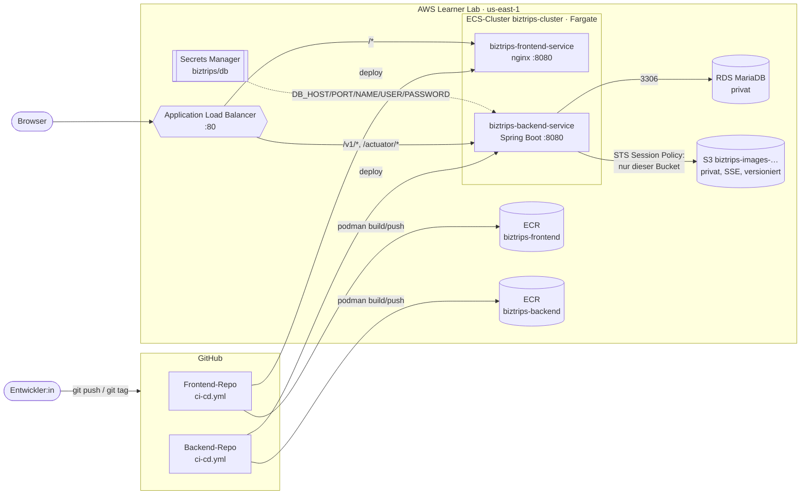

| Komponente | Entscheidung | Begründung |
|---|---|---|
| Zwei ECS-Services | `biztrips-frontend-service`, `biztrips-backend-service`, je eigene Task-Definition und eigenes ECR-Repo | unabhängig deploybar/skalierbar, analog RefCard02/03 |
| Application Load Balancer | ein ALB, Pfad-Routing `/v1/*` + `/actuator/*` → Backend, Rest → Frontend | stabile URL trotz wechselnder Task-IPs → `VITE_API_BASE_URL` bleibt gültig; kein CORS nötig |
| Security Groups | Internet → ALB:80 → Tasks:8080 → RDS:3306 (jeweils nur von der vorherigen SG) | kein direkter Zugriff auf Tasks oder Datenbank |
| RDS | MariaDB `db.t3.micro`, nicht öffentlich, verschlüsselt | zustandsbehaftet → verwalteter Dienst, Container bleiben stateless |
| Secrets Manager | `biztrips/db` (JSON: host, port, dbname, username, password) | ECS injiziert alle Verbindungsdaten beim Task-Start, nichts im Repo/Task-JSON |
| S3 | privat, Block Public Access, SSE-S3, Versionierung, Bucket-Policy (nur TLS, nur LabRole/voclabs) | Bilder dauerhaft und unabhängig von Tasks |

Die gesamte Infrastruktur wird reproduzierbar mit **[`infra/provision.sh`](infra/provision.sh)** (AWS CLI, idempotent) in der AWS CloudShell angelegt.
[`infra/verify.sh`](infra/verify.sh) zeigt den Zustand aller Ressourcen, [`infra/teardown.sh`](infra/teardown.sh) räumt alles wieder ab.

---

## 2. Aufgabe 1 – Zwei Repos, zwei Pipelines, Versionierung

Beide Repos sind Forks der Lehrer-Vorgaben ab Tag `v1-start`; alle Anpassungen sind als einzelne, beschriebene Commits nachvollziehbar.

### Pipeline (identischer Aufbau in beiden Repos: `.github/workflows/ci-cd.yml`)

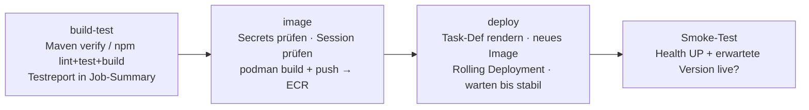

| Job | Backend | Frontend |
|---|---|---|
| **build-test** | `./mvnw verify` (JDK 21, Maven-Cache), 16 Unit-/Integrationstests, Surefire-Reports als Artefakt | `npm ci`, ESLint, Vitest (7 Tests, JUnit-Report), `vite build` |
| **image** | Multi-Stage `Dockerfile`: Maven/JDK 21 → JRE 21 alpine, non-root, HEALTHCHECK | Multi-Stage: Node 22 → `nginx-unprivileged`, `/healthz`, `/version.json` |
| | gebaut und gepusht mit **Podman** (`podman build --format docker`, `podman push`) | `VITE_API_BASE_URL` = URL des Backend-Service als Build-Arg |
| **deploy** | `.aws/task-definition.json` rendern → `amazon-ecs-render-task-definition` → `amazon-ecs-deploy-task-definition` (`wait-for-service-stability`) | gleich |
| **Smoke-Test** | `/actuator/health/readiness` = UP **und** `/actuator/info` meldet die gebaute Version | `/version.json` meldet die gebaute Version |

Robustheit: PRs bauen/testen nur; `concurrency` verhindert parallele Deployments; klare `::error`-Meldungen, wenn Secrets fehlen,
die Learner-Lab-Session abgelaufen ist oder eine Repository-Variable fehlt.

### Versionierung mit Git-Tags (SemVer)

| Ereignis | Version im Build | Image-Tags in ECR |
|---|---|---|
| Push auf `main` | `git describe`, z. B. `1.0.0-3-gab12cd3` | `main`, `sha-ab12cd3` |
| Tag `v1.1.0` | `1.1.0` | `1.1.0`, `1.1`, `latest`, `sha-…` |

- Deployt wird immer das unveränderliche `sha-<commit>`-Tag → jede laufende Task ist eindeutig einem Commit zuordenbar.
- Die Version steckt zusätzlich im Image (OCI-Labels), im Backend in `/actuator/info` (`build.version`) und im Frontend in `/version.json`.
- **Nachvollziehbarkeit über beide Repos:** Der Footer der Webseite zeigt `Frontend <version> · Backend <version>`.
- Release erstellen: `git tag -a v1.1.0 -m "…" && git push origin v1.1.0` (in jedem Repo unabhängig).

---

## 3. Aufgabe 2 – Backend an RDS und S3 (Least Privilege)

### RDS (MariaDB) – Konfiguration nur über Secrets

- [`application-mariadb.properties`](https://github.com/Panat-ZHH/refcard-05-be-springboot-businesstrips/blob/main/src/main/resources/application-mariadb.properties):
  `jdbc:mariadb://${DB_HOST}:${DB_PORT}/${DB_NAME}`, `${DB_USER}`, `${DB_PASSWORD}` – **kein Passwort im Code**.
- `provision.sh` erzeugt das DB-Passwort zufällig, legt es **direkt** im Secret `biztrips/db` ab und gibt es nie aus.
- Die Task-Definition referenziert nur die Secret-ARN ([`.aws/task-definition.json`](https://github.com/Panat-ZHH/refcard-05-be-springboot-businesstrips/blob/main/.aws/task-definition.json)):
  ```json
  "secrets": [
    { "name": "DB_HOST",     "valueFrom": "${DB_SECRET_ARN}:host::" },
    { "name": "DB_PASSWORD", "valueFrom": "${DB_SECRET_ARN}:password::" }, …
  ]
  ```
- Saubere Trennung über Spring-Profile: `default` (H2, Tests) · `mariadb` (RDS / lokal) · `s3` (Bilder in S3 / lokal S3Mock).
- Verbindung nachweisbar: `GET /actuator/health` → `components.db.status = UP` (`MariaDB`), `GET /v1/trips` liefert die Daten aus RDS;
  der Smoke-Test der Pipeline prüft das bei jedem Deployment.

### S3 – Bilder-Storage

- Neues Paket [`ch.bbw.trips.images`](https://github.com/Panat-ZHH/refcard-05-be-springboot-businesstrips/tree/main/src/main/java/ch/bbw/trips/images):
  Interface `ImageStorage` mit `LocalImageStorage` (Volume, Stand RefCard04) und `S3ImageStorage` (AWS SDK v2).
- API: `GET /v1/trips/{id}/image`, `PUT /v1/trips/{id}/image` (Upload, Typ-Prüfung per Magic Bytes, max. 5 MB), `GET /v1/images`.
- Demo-Bilder werden beim Start in den Bucket geseedet; Uploads werden mit SSE-S3 verschlüsselt abgelegt.
- **Fehlerfälle:** fehlende IAM-Rechte → `503 Problem Details` mit Hinweis auf die Policy, `imageStorage: DOWN` in `/actuator/health`.
  Der ALB-Health-Check nutzt bewusst die `readiness`-Gruppe (App + DB), damit ein S3-Problem nicht die ganze API abschaltet.

### IAM Least Privilege im Learner Lab

`iam:CreateRole` ist im Learner Lab gesperrt (nachgewiesen: `AccessDenied` beim Anlegen einer Task-Rolle) – ECS-Tasks können nur die
breit berechtigte `LabRole` verwenden. Lösung, die trotzdem **echtes Least Privilege zur Laufzeit** liefert:

1. Die Least-Privilege-Policy liegt versioniert im Repo: [`s3-least-privilege-policy.json`](infra/policies/s3-least-privilege-policy.json)
   ```json
   { "Effect": "Allow", "Action": "s3:ListBucket",                "Resource": "arn:aws:s3:::<bucket>" },
   { "Effect": "Allow", "Action": ["s3:GetObject","s3:PutObject"], "Resource": "arn:aws:s3:::<bucket>/trips/*" }
   ```
2. Das Backend nimmt beim Start per **STS `AssumeRole`** die LabRole mit dieser Policy als **Session Policy** an
   (die Trust-Policy der LabRole erlaubt das). Wirksame Rechte = Schnittmenge aus Rollen- und Session-Policy →
   nur noch `ListBucket` auf den Bucket sowie `Get/PutObject` unter `trips/*`. Kein Löschen, kein anderer Bucket, kein anderer Dienst.
3. Zusätzlich auf Ressourcenseite: Bucket-Policy ([`s3-bucket-policy.json`](infra/policies/s3-bucket-policy.json)) – nur TLS, nur `LabRole`/`voclabs`.
4. **Nachweis:** `./infra/verify.sh --iam` startet einen einmaligen ECS-Task mit der LabRole, der die Session Policy annimmt und testet:
   erlaubte Aktionen gehen, `DeleteObject`, fremde Prefixe, `ListBuckets`, ECR, RDS und Secrets Manager werden verweigert (siehe Screenshot).

> In einem regulären AWS-Account würde dieselbe Policy einer eigenen Task-Rolle `biztrips-backend-task-role` (Trust: `ecs-tasks.amazonaws.com`)
> zugewiesen und in der Task-Definition als `taskRoleArn` gesetzt (`vars.TASK_ROLE_NAME`) – der Code bleibt gleich, `S3_SCOPED_ROLE_ARN` entfällt.

---

## 4. Aufgabe 3 – ECS-Deployment und Learner-Lab-Zugangsdaten

### Zwei Fargate-Services

| | Frontend | Backend |
|---|---|---|
| Service | `biztrips-frontend-service` | `biztrips-backend-service` |
| Task | 0.25 vCPU / 512 MB, nginx :8080 | 0.5 vCPU / 1 GB, JVM `MaxRAMPercentage=75` |
| Container-Health-Check | `wget /healthz` | `wget /actuator/health/readiness`, `startPeriod 120s` |
| ALB-Target-Group | `/healthz` | `/actuator/health/readiness` |
| Logs | CloudWatch `/ecs/biztrips-frontend` (14 Tage) | CloudWatch `/ecs/biztrips-backend` (14 Tage) |

Beide Services: **Rolling Deployment** (`minimumHealthyPercent=100`, `maximumPercent=200` → kein Downtime),
**Deployment Circuit Breaker mit automatischem Rollback**, Graceful Shutdown (Spring `server.shutdown=graceful`, `stopTimeout`),
`deregistration_delay` 30 s, Container Insights für Metriken.

### Automatisches Redeploy bei Image-Änderung

Jeder Push auf `main` (oder ein Tag) erzeugt ein neues Image `sha-<commit>` → neue Task-Definition-Revision →
`amazon-ecs-deploy-task-definition` aktualisiert den Service → ECS startet neue Tasks, wartet bis sie im ALB healthy sind und stoppt dann die alten.
Danach **verifiziert der Smoke-Test**, dass wirklich die neue Version antwortet; die Job-Summary zeigt Version, Health und Daten aus RDS/S3.

### Learner-Lab-Zugangsdaten als GitHub Secrets

OIDC und eigene IAM-Rollen sind im Learner Lab gesperrt. Deshalb:

| Wo | Was |
|---|---|
| GitHub → Settings → Secrets and variables → Actions → **Secrets** (beide Repos) | `AWS_ACCESS_KEY_ID`, `AWS_SECRET_ACCESS_KEY`, `AWS_SESSION_TOKEN` |
| Workflow | `aws-actions/configure-aws-credentials@v4` mit `aws-access-key-id` / `aws-secret-access-key` / `aws-session-token` (kein `role-to-assume`) |
| Repository-**Variables** (nicht geheim) | `APP_URL`, `VITE_API_BASE_URL`, `S3_BUCKET`, `DB_SECRET_ARN` |
| Im Code / Repo | **keine** Zugangsdaten (lokale Compose-Werte nur in `.env.example` als offensichtliche Dev-Platzhalter, `.env` ist ignoriert) |

**Prozess bei Ablauf der Session (ca. alle 4 Stunden):**

1. Learner Lab → *Start Lab* → warten bis der Punkt grün ist → *AWS Details* → *AWS CLI: Show*.
2. Die drei Werte in **beiden** Repos unter *Settings → Secrets and variables → Actions* aktualisieren
   (oder per CLI: `gh secret set AWS_SESSION_TOKEN -R Panat-ZHH/refcard-05-fe-react-vite` usw.).
3. Fehlgeschlagenen Workflow mit *Re-run jobs* neu starten.
4. Erkennbar ist eine abgelaufene Session an der Pipeline-Meldung **„Learner-Lab-Session abgelaufen“** im Job `image`.
5. Nach einem Lab-Neustart: RDS ist evtl. gestoppt → `aws rds start-db-instance --db-instance-identifier biztrips-db`; ECS-Services starten automatisch.

### Vergleich mit OIDC (Best Practice im produktiven Account)

| | Learner Lab: Session-Credentials als Secrets | Produktion: OIDC (EX-03) |
|---|---|---|
| Gespeicherte Geheimnisse in GitHub | 3 Secrets (temporär, aber gespeichert) | **keine** |
| Gültigkeit | bis Lab-Ende (~4 h), dann manuell erneuern | pro Workflow-Lauf ein Token (≤ 1 h), automatisch |
| Rechte | volle Rechte der Lab-Session | eigene Rolle, auf Repo/Branch eingeschränkte Trust-Policy, minimale Policies |
| Risiko bei Leak | Missbrauch bis Session-Ende | praktisch keines (Token kurzlebig, an Repo gebunden) |
| Workflow | `aws-access-key-id` … | `permissions: id-token: write` + `role-to-assume` |

---

## 5. Aufgabe 4 – Lokale Entwicklung mit Podman Compose

Ordner [`docker-compose-local/`](docker-compose-local): Frontend + Backend + MariaDB + **S3Mock** (S3-kompatibel → derselbe `S3ImageStorage`-Code wie auf AWS; MinIO veröffentlicht keine freien Images mehr)
+ optional phpMyAdmin. Kein AWS-Zugang nötig.

```bash
# einmalig: Podman + podman-compose
brew install podman && podman machine init && podman machine start
pip install podman-compose

# alle drei Repos nebeneinander klonen
git clone https://github.com/Panat-ZHH/refcard-05-fe-react-vite.git
git clone https://github.com/Panat-ZHH/refcard-05-be-springboot-businesstrips.git
git clone https://github.com/Panat-ZHH/refcard-05-fullstack-aws.git

# starten (legt .env aus .env.example an, baut, wartet bis alles healthy ist)
cd refcard-05-fullstack-aws/docker-compose-local
./start.sh
```

| Dienst | URL |
|---|---|
| Frontend | http://localhost:3000 |
| Backend | http://localhost:8080/v1/trips · Health: http://localhost:8080/actuator/health |
| S3 (Mock-API) | http://localhost:9090/biztrips-images-local |
| phpMyAdmin | http://localhost:8082 (`podman-compose --profile tools up -d`) |

- **Startreihenfolge über Healthchecks:** MariaDB healthy + S3Mock healthy (Bucket wird beim Start angelegt) → Backend healthy → Frontend.
- **Umgebungsvariablen:** `.env.example` → `.env` (Git-ignoriert): `DB_*`, `S3_*`, optional `BACKEND_CONTEXT`/`FRONTEND_CONTEXT` (andere Pfade), `FRONTEND_PORT`.
- Frontend lokal: `VITE_API_BASE_URL=http://localhost:8080/` (Build-Arg); Backend erlaubt CORS für `http://localhost:3000`.
- Release aus ECR lokal starten: `./use-ecr-images.sh 1.0.0`.
- Stoppen: `podman-compose down` · inkl. Daten: `podman-compose down -v`.
- Die Compose-Datei folgt der Compose-Spezifikation und funktioniert auch mit `podman compose` oder Docker Compose.
- **Automatisch getestet:** Workflow [`compose-smoke-test.yml`](.github/workflows/compose-smoke-test.yml) startet das Gesamtsystem mit podman-compose und prüft End-to-End (Health, Trips, Bild-Download/-Upload, Frontend, CORS).

---

## 6. Nachweise (Screenshots)

Alle Screenshots stammen vom 17.11.2026 (Release `v1.0.0`) und zeigen den Account `851725350838` / GitHub `Panat-ZHH`.

### Ergebnis: App live auf AWS (Release 1.0.0)
Frontend aus ECS (nginx), Trips aus RDS, Bilder aus S3, Footer zeigt die Versionen beider Repos.

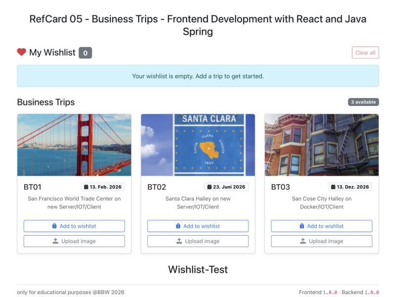

### Workflows (GitHub Actions)
| Backend `v1.0.0`: build → Podman-Image → ECR → ECS | Backend: Smoke-Test nach dem Deployment |
|---|---|
| 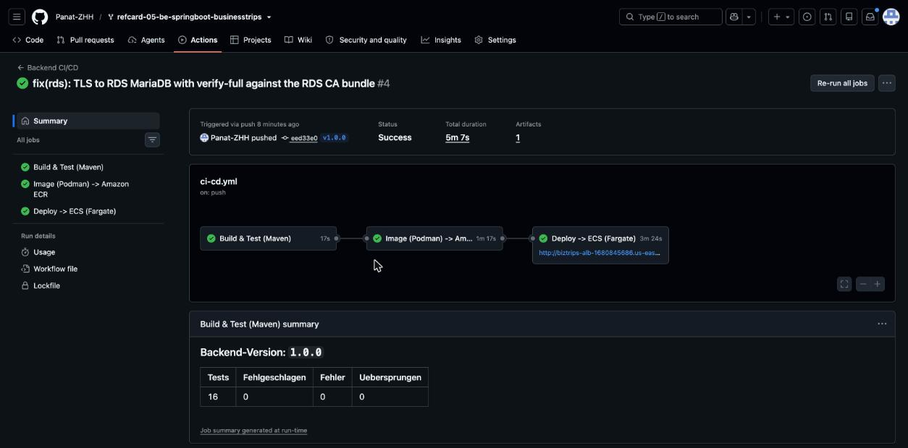 | 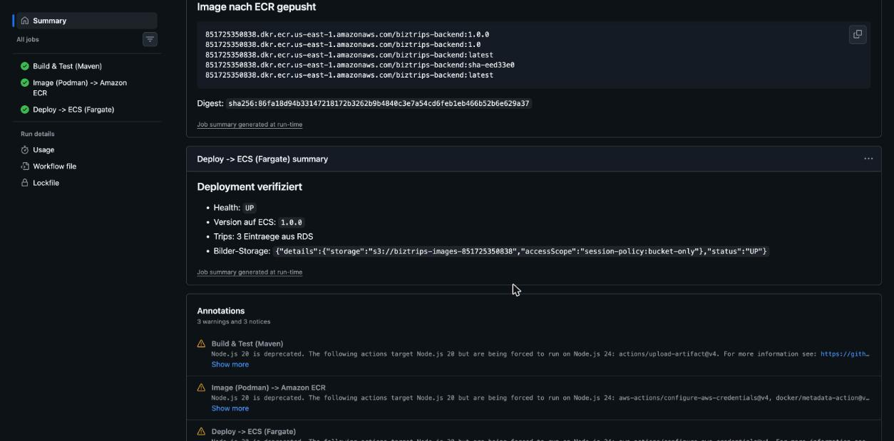 |
| **Frontend: lint/test/build → ECR → ECS** | **Compose-Smoke-Test (Podman, lokales Gesamtsystem)** |
| 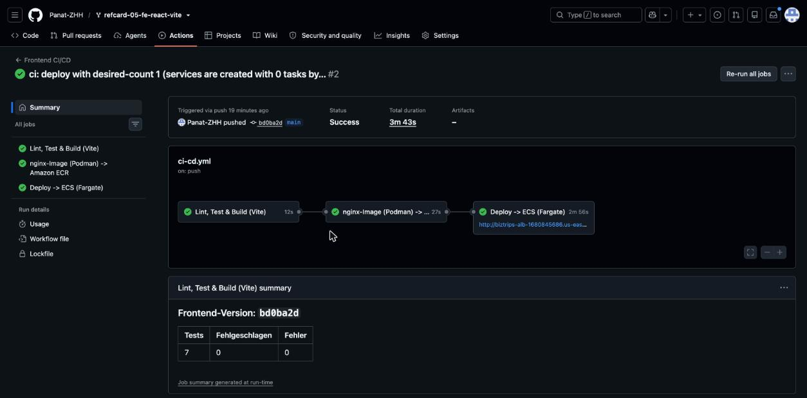 | 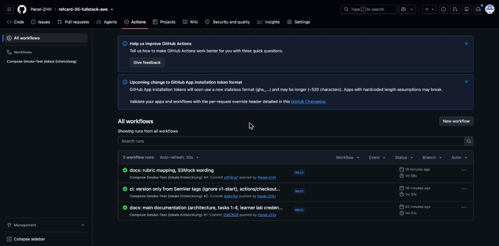 |

### Amazon ECR – Image-Tags aus Git-Tags
| Backend (`1.0.0`, `1.0`, `latest`, `sha-…`, `main`) | Frontend |
|---|---|
| 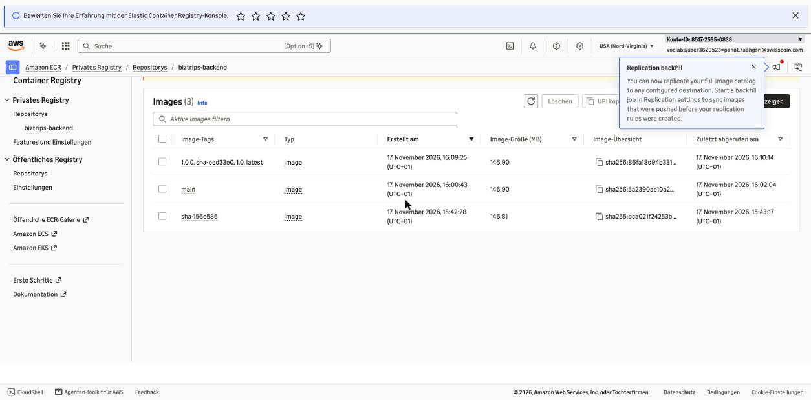 | 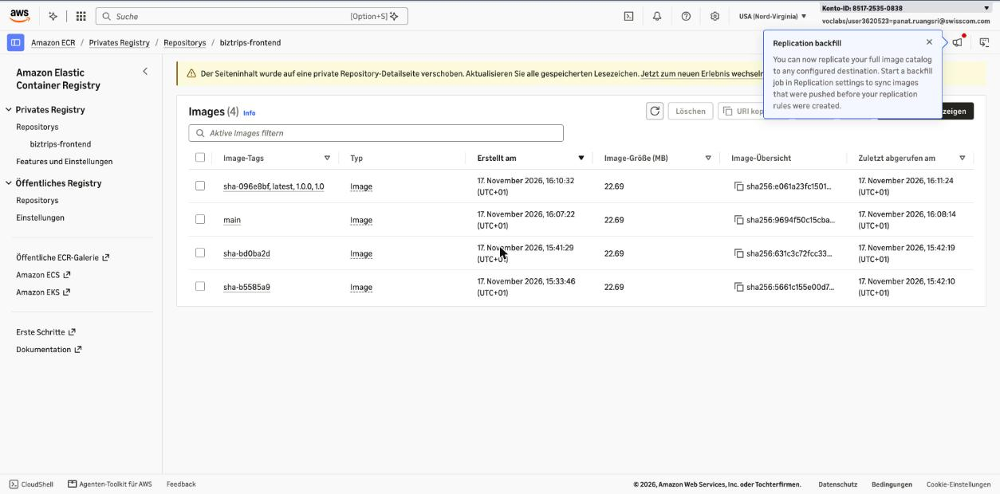 |

### Amazon ECS – zwei Fargate-Services
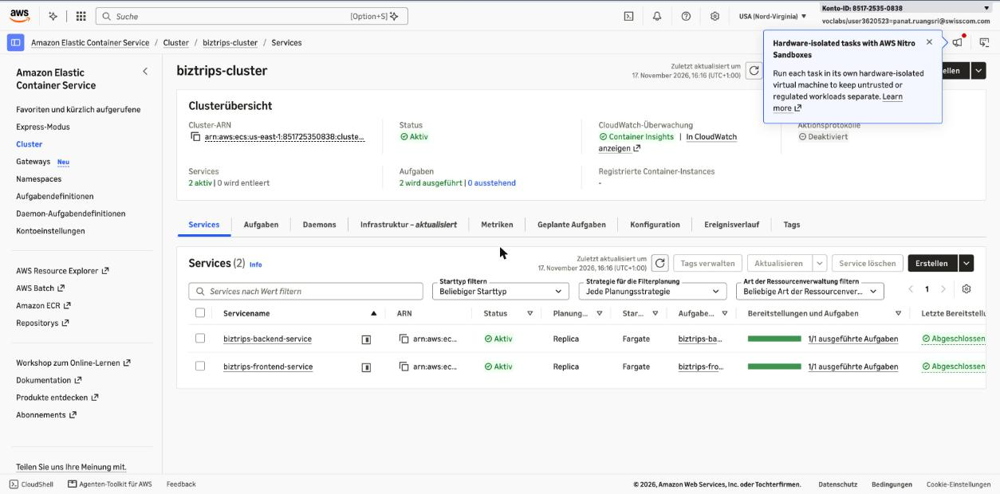

### Amazon RDS – MariaDB
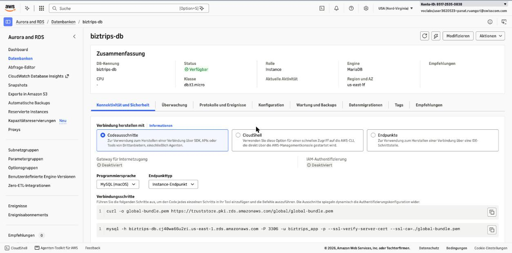

### Amazon S3 – Bilder und Bucket-Policy
| Objekte unter `trips/` | Bucket-Policy (nur TLS, nur LabRole/voclabs), Block Public Access |
|---|---|
| 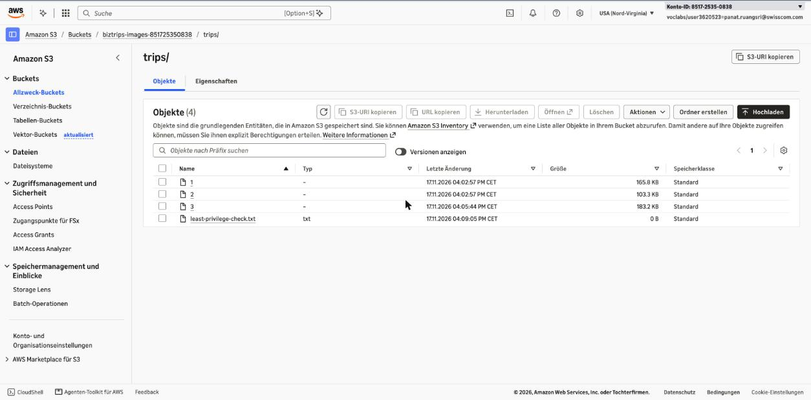 | 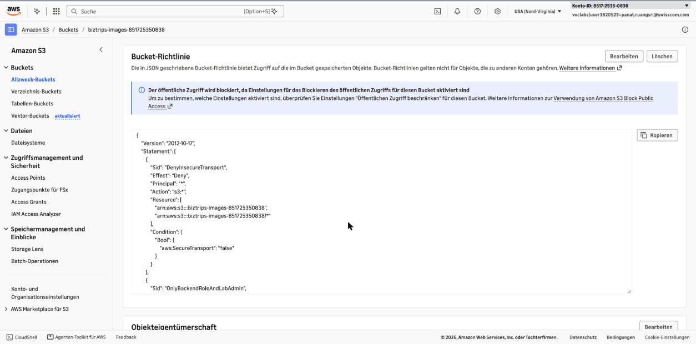 |

### IAM Least Privilege – Nachweis (`./infra/verify.sh --iam`)
Ein ECS-Task mit der LabRole nimmt die Session Policy an: erlaubte Aktionen funktionieren, alles andere wird verweigert.

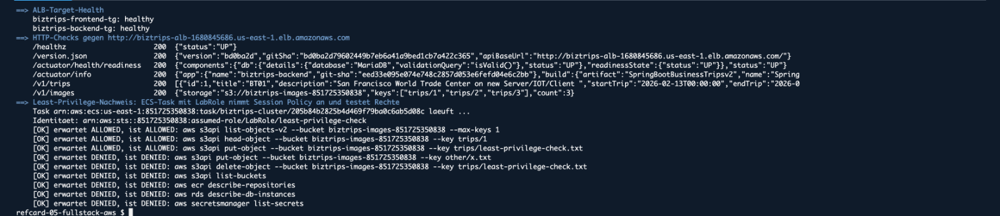

### Commits (individuelle Lösung)
| Backend | Frontend |
|---|---|
| 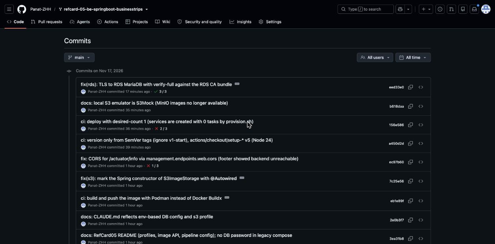 | 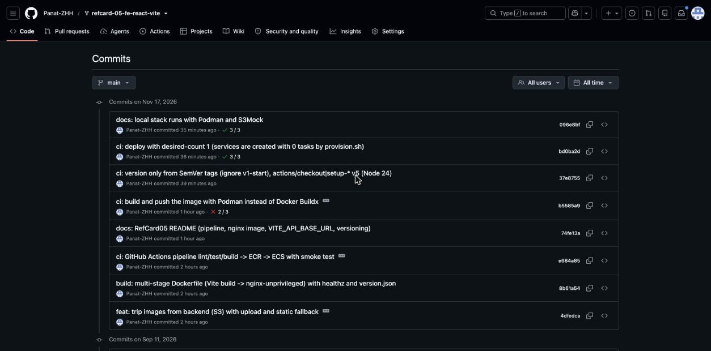 |

### Lokale Entwicklung mit Podman
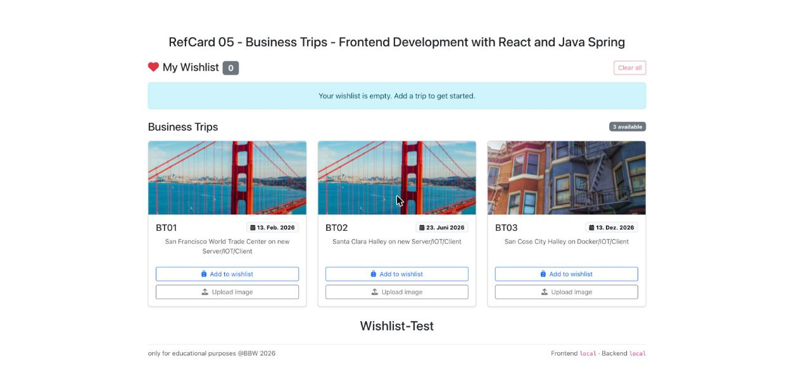

### Probleme und Lösungen (Lessons Learned)

| Problem | Ursache | Lösung |
|---|---|---|
| `CreateCluster`: *Unable to assume the service linked role* | erster ECS-Cluster im Account, Service-Linked-Role entsteht erst | Retry-Schleife in `provision.sh` |
| Backend startet mit Profil `s3` nicht | Spring fand mehrere Konstruktoren in `S3ImageStorage` | `@Autowired` + Kontext-Test `S3ProfileContextTest` (beim lokalen Podman-Test entdeckt) |
| MinIO-Images nicht mehr abrufbar | MinIO verteilt keine freien Images mehr | lokaler S3-Ersatz Adobe S3Mock |
| ALB 503 nach erstem Deploy | Services mit `desiredCount 0` angelegt | `desired-count: 1` im Deploy-Schritt |
| `Connections using insecure transport are prohibited` | RDS MariaDB erzwingt TLS | `sslMode=verify-full` gegen das RDS-CA-Bundle im Image |
| Version „1-start-13-g…“ | `git describe` fand den Lehrer-Tag `v1-start` | nur SemVer-Tags `v*.*.*` zählen |
| *The security token included in the request is invalid* | Session-Token beim Kopieren abgeschnitten | Secret neu gesetzt; Pipeline meldet den Fall mit klarer Fehlermeldung |
| Footer „Backend nicht erreichbar“ | Actuator hat eigenes CORS-Mapping | `management.endpoints.web.cors.*` |


---

## 7. Bewertungsraster – wo ist was?

| Kriterium (Punkte) | Umsetzung | Nachweis |
|---|---|---|
| Frontend-Pipeline (3) | lint → Vitest → Vite-Build → Podman-Image → ECR → ECS → Smoke-Test, Job-Summary mit Testergebnissen, klare Fehlermeldungen | [FE ci-cd.yml](https://github.com/Panat-ZHH/refcard-05-fe-react-vite/blob/main/.github/workflows/ci-cd.yml), [FE Actions](https://github.com/Panat-ZHH/refcard-05-fe-react-vite/actions) |
| Backend-Pipeline (3) | Maven verify (16 Tests) → Podman-Image (Multi-Stage) → ECR → ECS → Smoke-Test inkl. Versions- und DB-Check | [BE ci-cd.yml](https://github.com/Panat-ZHH/refcard-05-be-springboot-businesstrips/blob/main/.github/workflows/ci-cd.yml), [BE Actions](https://github.com/Panat-ZHH/refcard-05-be-springboot-businesstrips/actions) |
| Versionierung (3) | SemVer-Tags `vX.Y.Z` → `X.Y.Z`, `X.Y`, `latest`, `sha-…`; Version in `/actuator/info`, `/version.json`, Footer zeigt beide | [Abschnitt 2](#versionierung-mit-git-tags-semver), ECR-Screenshots |
| RDS über Secrets (3) | Profil `mariadb`, alle 5 Verbindungswerte aus Secrets Manager, Passwort nie im Klartext | [Abschnitt 3](#rds-mariadb--konfiguration-nur-über-secrets), Health-Screenshot |
| S3 + Least Privilege (3) | `S3ImageStorage`, STS-Session-Policy nur auf Bucket/Prefix, Bucket-Policy, Fehlerfälle als 503 + Health | [Abschnitt 3](#iam-least-privilege-im-learner-lab), `verify.sh --iam` |
| ECS Frontend (3) | Fargate, nginx-unprivileged, Health-Checks (Container + ALB), Limits, Circuit Breaker | [Abschnitt 4](#4-aufgabe-3--ecs-deployment-und-learner-lab-zugangsdaten) |
| ECS Backend (3) | Fargate, readiness-Health-Check, JVM-Limits, Graceful Shutdown, Circuit Breaker | [Abschnitt 4](#4-aufgabe-3--ecs-deployment-und-learner-lab-zugangsdaten) |
| Automatisches Redeploy (3) | jeder Push/Tag → neue Task-Def-Revision → Rolling Deployment → Smoke-Test prüft neue Version | Workflow-Summaries, ECS-Deployments |
| Learner-Lab-Secrets (3) | 3 GitHub Secrets, keine Zugangsdaten im Code, Erneuerungsprozess + OIDC-Vergleich | [Abschnitt 4](#learner-lab-zugangsdaten-als-github-secrets) |
| Lokale Entwicklung (3) | Podman Compose: FE + BE + MariaDB + S3Mock, Healthchecks/Startreihenfolge, `start.sh`, CI-getestet | [Abschnitt 5](#5-aufgabe-4--lokale-entwicklung-mit-podman-compose) |
| Dokumentation (5) | dieses README + READMEs je Repo, Diagramme, Screenshots | – |
| Nachvollziehbarkeit (3) | kleine, beschriebene Commits in allen 3 Repos, Workflow-Runs mit Summaries | Commit-Historien |


